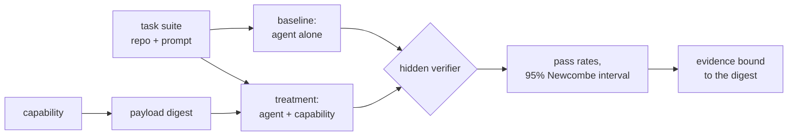

# Sigil

**Every AI agent capability, proven.**

[](https://sigil-lab.vercel.app)

[Observatory](https://sigil-lab.vercel.app) · [Method](spec/METHODOLOGY.md) · [Threat model](spec/THREAT-MODEL.md) · [Agents matrix](docs/AGENTS-MATRIX.md) · [MCP server](docs/MCP.md) · [Contributing](CONTRIBUTING.md)

Sigil is the open proving ground for AI agent capabilities: skills, rules, subagents, commands,
hooks, MCP servers and policies. It runs each one through A/B tests on hidden tests to see whether
it makes a coding agent better, watches it in a sandbox full of tripwires, seals the exact bytes it
tested, and installs that same content into the agent you use.

## Why

Agent skills are published faster than anyone can read them, and almost none are measured. The
studies that do measure them are sobering:

- **SkillsBench** ([arXiv:2602.12670](https://arxiv.org/abs/2602.12670)): curated skills raised the
  average pass rate from 33.9% to 50.5% across 18 model-harness setups, but the gain ranged from
  +4.1 to +25.7 points depending on the setup.
- **SWE-Skills-Bench** ([arXiv:2603.15401](https://arxiv.org/abs/2603.15401)): on real software
  engineering tasks, **92 of 98 skills had no statistically significant effect**, and the average pass
  rate moved from 76.6% to 76.9%.

A skill can help, do nothing, or make an agent worse, and you can't tell which from its README or its
star count. Sigil measures it, in the open, and anyone can reproduce the result.

## What it does

| | |
| --- | --- |
| **Prove** | Every task runs under two conditions, with and without the capability, several times each, on the same agent, model and image. A hidden verifier the agent never sees decides pass or fail. Verdicts come from the difference in pass rates with a 95% Newcombe interval: `proven`, `no-effect`, `inconclusive` or `harmful`. |
| **Contain** | Runs happen in a Docker sandbox with no direct internet, a logging egress proxy and per-run honeytokens. Reading a planted secret, an unexpected network call, a write outside the project or an attempt at persistence is recorded against the capability. |
| **Scan** | `sigil scan` runs 52 static rules mapped to the [OWASP Agentic Skills Top 10](https://owasp.org/www-project-agentic-skills-top-10/), with SARIF output. On 47 skills from anthropics/skills, obra/superpowers and vercel-labs/agent-skills it raises zero high or critical findings, and it flags all 14 published malicious samples from Snyk and Trail of Bits ([benchmark](packages/sigil/src/scan/BENCHMARK.md)). |
| **Seal** | Evidence is bound to a payload digest you can recompute with plain `shasum`. Change one byte and the old results stop applying. Each digest gets a generated glyph, so different content looks visibly different. |
| **Install everywhere** | One source compiles to the native files of 22 coding agents (Claude Code, Codex, Cursor, GitHub Copilot, Gemini CLI, OpenCode, Windsurf, Cline, Kiro, Amp and more) plus a generic `AGENTS.md` target. Every mapping cites the vendor's docs with a date ([matrix](docs/AGENTS-MATRIX.md)). `sigil add` verifies hashes before writing, merges into existing config instead of overwriting it, and `sigil remove` restores files byte for byte. |
| **Ask from your agent** | `sigil mcp` lets an agent detect the project's stack, find capabilities for it, read the evidence and preview an install mid-task. It's read-only: installing stays a human decision ([setup](docs/MCP.md)). |

## Quick start

Sigil isn't on npm yet. Until the first release, run it from a clone (Node 22+, pnpm):

```sh
git clone https://github.com/dgesteves/sigil && cd sigil
pnpm install && pnpm build
alias sigil="node $PWD/packages/sigil/dist/cli.js"
```

Then, in your own project:

```sh
sigil add zod/zod-4 --dry-run        # what it would write, for the agents this project uses
sigil add zod/zod-4                  # verify the hashes, show the plan, ask, install
sigil list                           # what is installed, and anything edited since
sigil scan ./skills --fail-on high   # scan your own skills; --sarif out.sarif for code scanning
sigil mcp                            # serve the catalog to your agent over MCP
```

Writing a capability or a proof suite:

```sh
sigil validate catalog/skills/<namespace>/<slug>
sigil task check tasks/<suite>       # the verifier must fail on the starting repo and pass on the solution
sigil prove catalog/skills/<namespace>/<slug> --suite <suite> --runs 6
sigil digest catalog/skills/<namespace>/<slug>
```

## How a proof works



- The verifier is copied in only after the agent stops, and protected files are restored first, so a
  run passes only on correct code. Tampering is recorded but never scored as a pass.
- Runs never see the operator's own configuration, memory or skills, and run order is randomized
  with a recorded seed.
- Task suites must fail on the starting repo and pass on the reference solution, every time, before
  any agent sees them.

The full method, including what Sigil does not claim, is in [METHODOLOGY.md](spec/METHODOLOGY.md).

## Trust levels

| Level | Meaning |
| --- | --- |
| `submitted` | In the catalog, not yet validated for this exact digest. Read it before installing. |
| `validated` | Structure and security checks pass for this digest. |
| `verified` | Validated, a clean canary run in the sandbox, and approved by a maintainer. |
| `revoked` | Verification withdrawn, with the reason published. `sigil add` refuses it. |

Uplift is reported separately: `proven`, `no-effect`, `inconclusive`, `harmful` or `untested`.
Levels are computed from evidence, never declared.

## Status

Sigil is new, and the numbers say so. The [observatory](https://sigil-lab.vercel.app) shows the live
state, and the header image above is rendered from the registry on every deploy.

- **Catalog:** 16 skills and a launch collection, covering React, Next.js 16, Vue 3.5, Svelte 5,
  Angular 22, Express 5, Zod 4, the AI SDK, MCP servers in TypeScript, OAuth/OIDC, Postgres
  migrations, GitHub Actions hardening, Kubernetes, Spring Boot 4, axum 0.8 and ASP.NET Core minimal
  APIs, with 48 hidden-test tasks between them. All are `submitted` and `untested` until their first
  published runs.
- **First lab runs** (Claude Code with Claude Haiku, local) found ceiling effects: today's models
  already pass many library-migration tasks without help. Suites are being hardened with tasks the
  baseline fails before any result is published. No number goes up until a run produced it.
- **Next:** CI-produced evidence with GitHub artifact attestations, more agents in the lab, the first
  npm release, and the report "We A/B-tested the most-installed agent skills".

## Repository

| Path | What lives there |
| --- | --- |
| `packages/sigil` | The CLI and library: `core` (schemas, digest, levels, registry), `scan`, `compile`, `lab`, `mcp` |
| `catalog/` | Capabilities: a `sigil.yaml` plus the native payload |
| `tasks/` | Proof suites: starting repo, prompt, hidden `verify/`, reference `solution/` |
| `taxonomy/` | Domains, industries, lifecycle stages, and 197 technologies with detection signatures |
| `spec/` | The method, the threat model and the JSON Schemas |
| `site/` | The observatory (Next.js), which reads `registry.json` |

## Contributing

Capabilities, proof suites, agent mappings and scanner rules are all welcome. Start with
[CONTRIBUTING.md](CONTRIBUTING.md). Ground rules: never fabricate evidence, every scanner rule ships
with positive and negative fixtures, and every agent mapping cites a source. Security issues go
through [private vulnerability reporting](SECURITY.md).

MIT © Diogo Esteves
